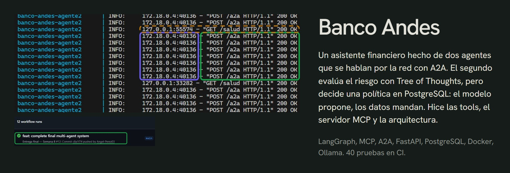
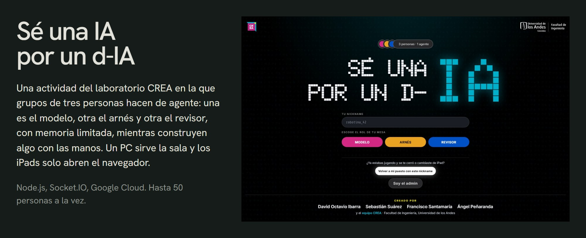
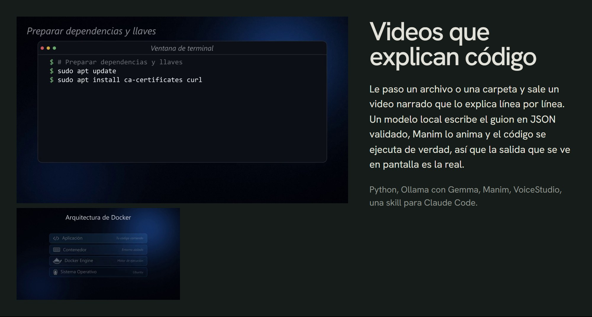
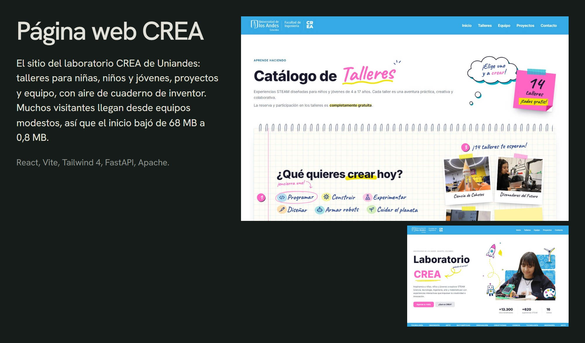
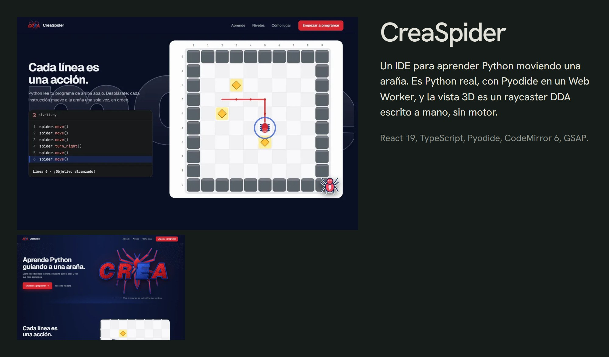
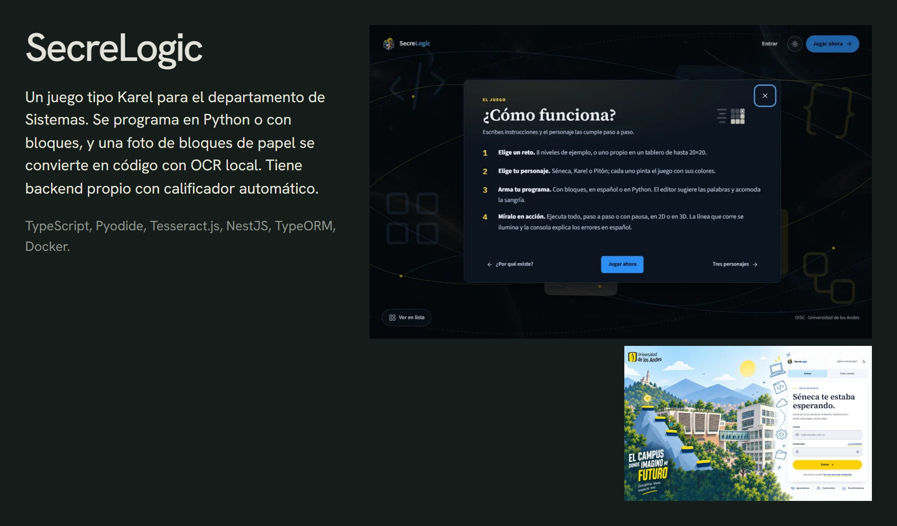
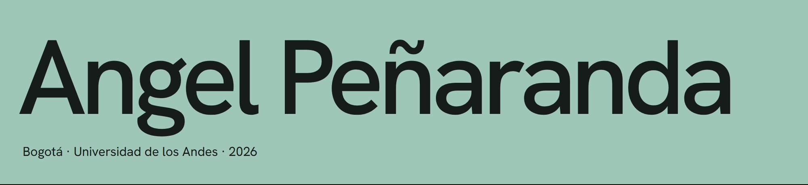

[LinkedIn](https://www.linkedin.com/in/angelpe%C3%B1aranda-developer) · [ajpp2803@gmail.com](mailto:ajpp2803@gmail.com) · [a.penarandap@uniandes.edu.co](mailto:a.penarandap@uniandes.edu.co)

 

### Agentes de IA

Sé una IA por un d-IA está en línea en [unaiapordia.vercel.app](https://unaiapordia.vercel.app). Banco Andes y el generador de videos viven en repos privados; si quieres verlos, escríbeme.

 

### Webs y herramientas para aprender

En línea: [crea.virtual.uniandes.edu.co](https://crea.virtual.uniandes.edu.co/) · [creaspider.vercel.app](https://creaspider.vercel.app) · [secre-logic.vercel.app](https://secre-logic.vercel.app)

 

### Más trabajo

- **AjHA, suite end-to-end** (proyecto de grado). Más de 90 escenarios en Gherkin, con Kraken y WebdriverIO, para el sistema de ajuste de horario académico de Uniandes. La va a mantener el equipo de QA de la Vicerrectoría de Transformación Digital.
- **[ReCREA tu luz](https://recrea-pi.vercel.app).** Puzzles de óptica con la física de verdad: Snell con dispersión de Cauchy, Fresnel, Malus y Beer-Lambert. Un prisma abre el arcoíris por sí solo.
- **CORE / STUDIO.** Editor 3D en el navegador para piezas de una Prusa CORE One: plantillas paramétricas, imagen a sólido y soportes calculados en un worker. three.js sobre Cloudflare Workers.
- **CREAcut.** Recibe un video en pantalla verde y su guion, y entrega el corte final.
- **CREA tu propio videojuego.** El taller donde niñas y niños programan un juego en Python, con su página.
- **[CanSat Ground](https://github.com/CREA-Ingenieria/Cansat-SOFTWARE).** Estación terrena web: telemetría por Web Serial, gráficas y la orientación 3D del satélite.
- **Hardening de servidores.** Ubuntu y Red Hat asegurados desde Kali: SSH solo con llave, firewall en DROP, SELinux, AIDE y Lynis.

 

### Con qué trabajo

**Agentes:** LangGraph, MCP, A2A (JSON-RPC), RAG, Ollama, LangSmith, skills y hooks para Claude Code. 
**Web y 3D:** TypeScript, React, Vite, Tailwind, three.js, Canvas, GSAP, Pyodide, Web Workers. 
**Backend:** Node.js, NestJS, FastAPI, Python, Java, Go, PostgreSQL, Docker, Cloudflare Workers. 
**Calidad:** Kraken, WebdriverIO, Gherkin, Pytest, GitHub Actions.

 

