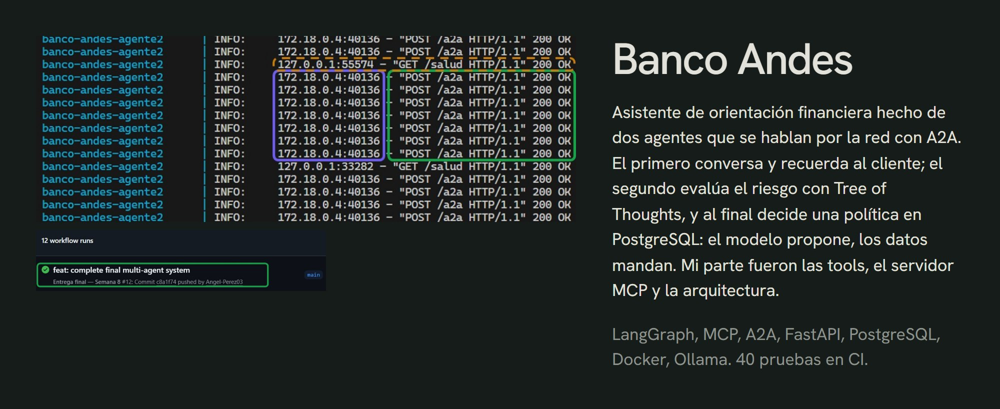
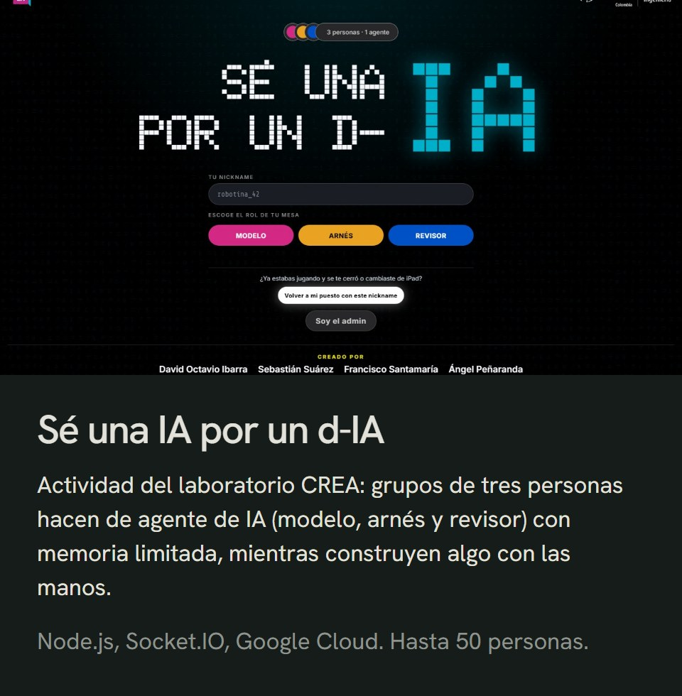
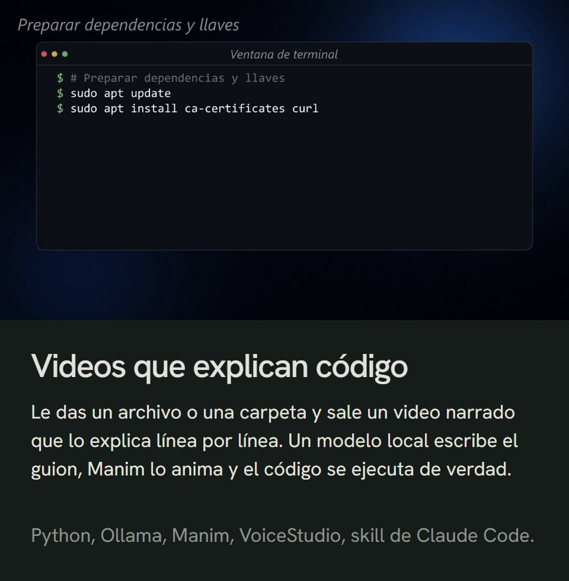
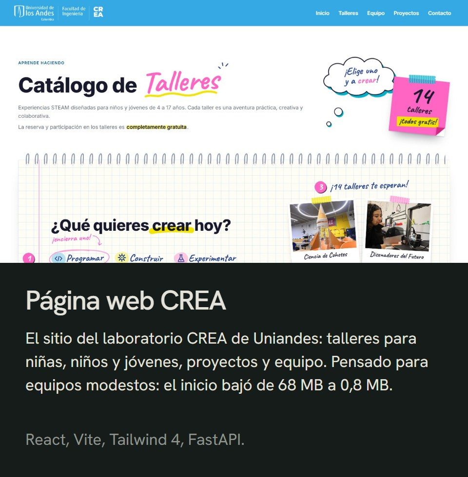
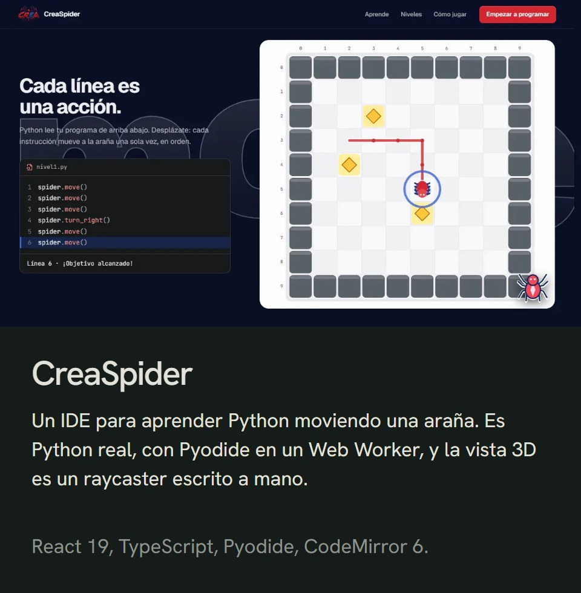
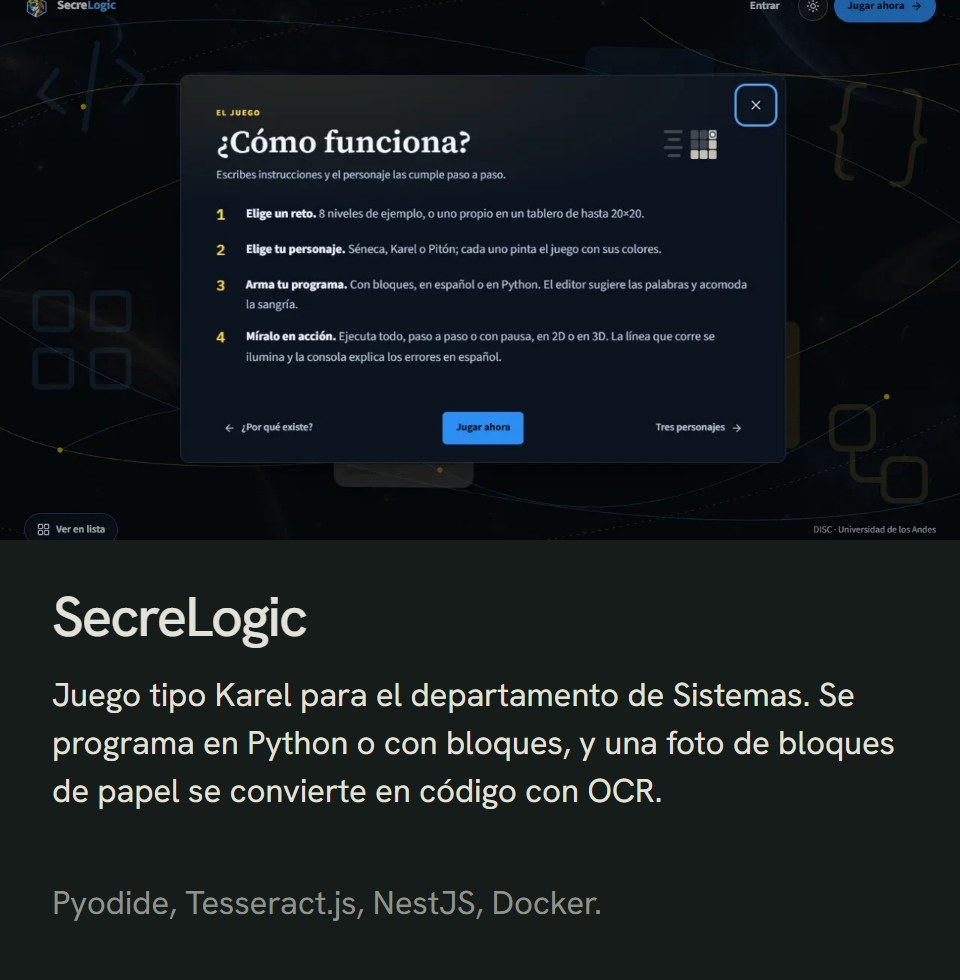
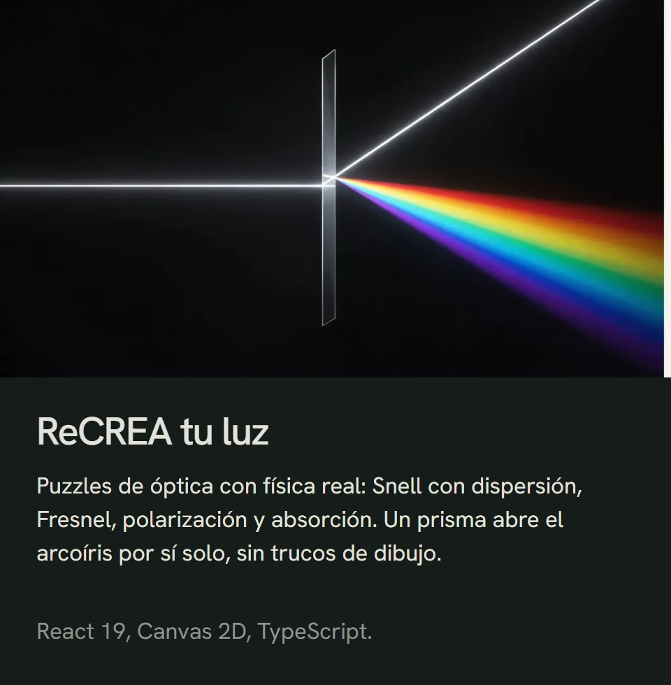
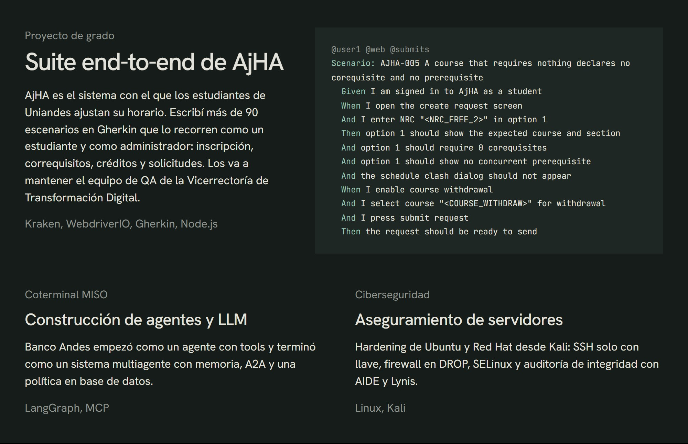

[LinkedIn](https://www.linkedin.com/in/angelpe%C3%B1aranda-developer) · [ajpp2803@gmail.com](mailto:ajpp2803@gmail.com) · [a.penarandap@uniandes.edu.co](mailto:a.penarandap@uniandes.edu.co)

### Sobre mí

Estoy terminando Ingeniería de Sistemas y Computación en la Universidad de los Andes y hago el coterminal de la Maestría en Ingeniería de Software. Me gusta construir el sistema completo: el motor que hace el trabajo difícil (un grafo de agentes, un solver de óptica, un raycaster) y la interfaz que lo vuelve fácil de usar. Después lo pruebo de punta a punta, porque si no tiene pruebas no está terminado.

- **Ahora mismo:** mi proyecto de grado, una suite end-to-end para el sistema de ajuste de horario de Uniandes.
- **Lo que más disfruto:** agentes de IA que delegan y se revisan entre sí, y herramientas para que otros aprendan a programar.
- **Cómo trabajo:** arquitectura limpia, decisiones escritas y CI en verde antes de entregar.

 

### Agentes de IA

Sé una IA por un d-IA está en línea en [unaiapordia.vercel.app](https://unaiapordia.vercel.app).

 

### Webs y herramientas para aprender

En línea: [crea.virtual.uniandes.edu.co](https://crea.virtual.uniandes.edu.co/) · [creaspider.vercel.app](https://creaspider.vercel.app) · [secre-logic.vercel.app](https://secre-logic.vercel.app) · [recrea-pi.vercel.app](https://recrea-pi.vercel.app)

 

### Este semestre · 2026-20

 

### También

- **CORE / STUDIO.** Editor 3D en el navegador para piezas de una Prusa CORE One, con soportes calculados en un worker. three.js sobre Cloudflare Workers.
- **CREAcut.** Recibe un video en pantalla verde y su guion, y entrega el corte final.
- **CREA tu propio videojuego.** El taller donde niñas y niños programan un juego en Python, con su página.
- **[CanSat Ground](https://github.com/CREA-Ingenieria/Cansat-SOFTWARE).** Estación terrena web con telemetría por Web Serial y la orientación 3D del satélite.

 

### Stack

**Agentes:** LangGraph, MCP, A2A (JSON-RPC), RAG, Ollama, LangSmith, skills y hooks para Claude Code. 
**Web y 3D:** TypeScript, React, Angular, Vite, Tailwind, three.js, Canvas, GSAP, Pyodide. 
**Backend:** Node.js, NestJS, FastAPI, Python, Java, Go, PostgreSQL, Docker, Cloudflare Workers. 
**Calidad:** Kraken, WebdriverIO, Gherkin, Pytest, GitHub Actions.
